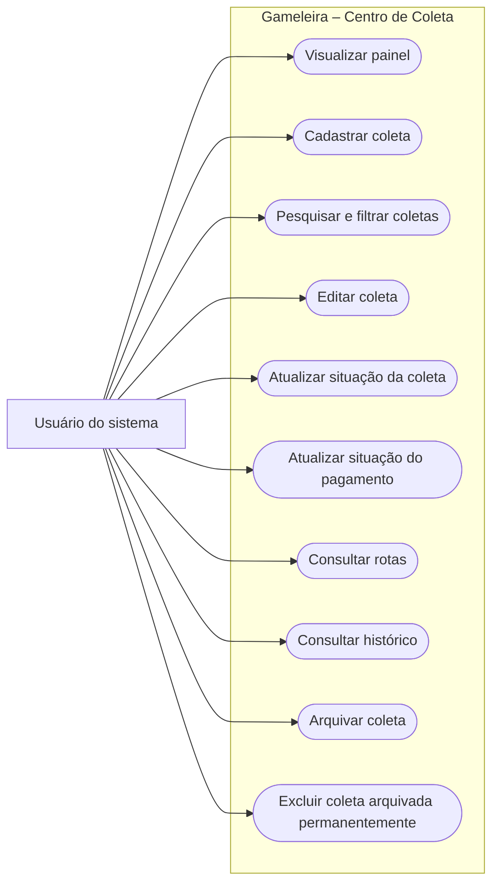
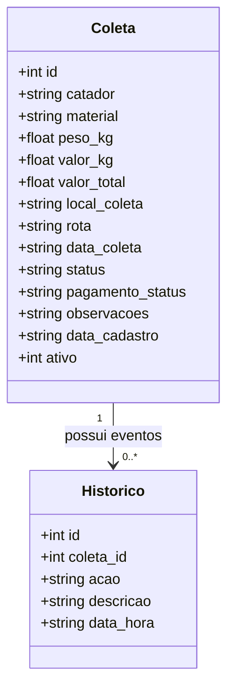
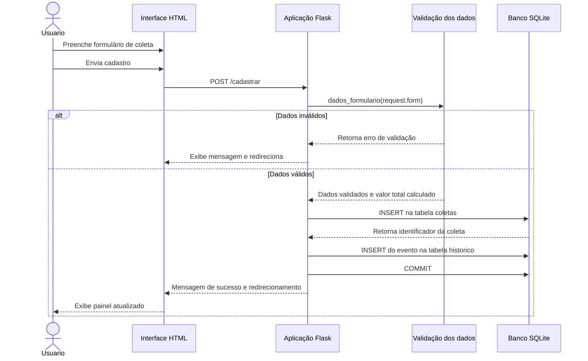
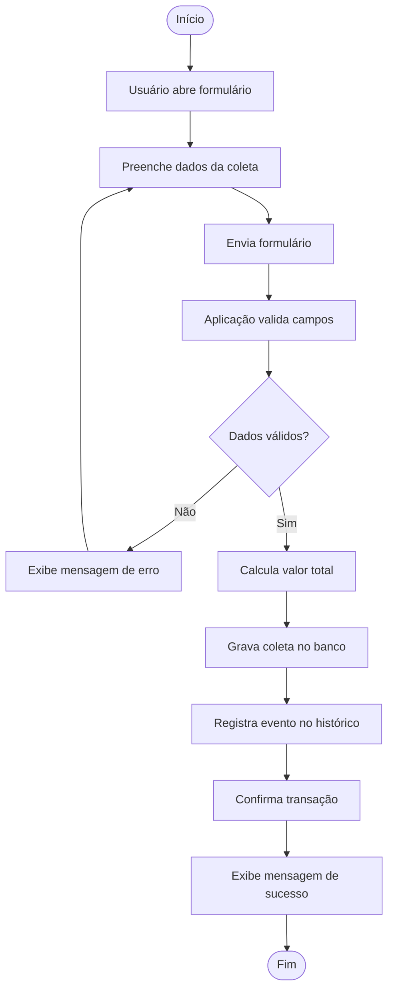

# Gameleira – Centro de Coleta
## Diagramas UML e Modelagem da Aplicação

**Projeto:** Gameleira – Centro de Coleta  
**Tecnologias identificadas:** Python, Flask, SQLite, HTML e CSS  
**Finalidade:** apoiar o registro e o acompanhamento de coletas de materiais recicláveis.

> Os diagramas abaixo representam as funcionalidades identificadas na versão atual do sistema. Eles documentam o comportamento existente, sem afirmar funcionalidades que ainda não foram implementadas.

---

## 1. Diagrama de casos de uso

**Descrição:** o usuário interage com o sistema para registrar e acompanhar coletas, consultar rotas e histórico, atualizar situações e administrar registros arquivados.

---

## 2. Diagrama de classes / modelo de domínio

**Descrição:** a classe `Coleta` representa os registros de materiais recebidos/coletados. A classe `Historico` representa os eventos registrados durante o ciclo de vida de uma coleta.

**Nota técnica:** o relacionamento é utilizado nas consultas da aplicação. Na estrutura física analisada, `historico.coleta_id` não possui restrição `FOREIGN KEY` declarada no SQLite.

---

## 3. Diagrama de sequência – cadastro de coleta

**Descrição:** o cadastro começa no formulário, passa pela validação no backend e, se os dados forem válidos, grava a coleta e seu evento de cadastro no banco de dados.

---

## 4. Diagrama de atividade – ciclo de cadastro

---

## 5. Regras de negócio identificadas

1. O cadastro exige nome do catador, material, local e data da coleta.
2. O material deve pertencer às opções disponibilizadas pelo sistema.
3. O peso deve ser maior que zero.
4. O valor por quilograma não pode ser negativo.
5. O valor total é calculado pela aplicação multiplicando o peso pelo valor por quilograma.
6. A situação da coleta pode ser `Pendente`, `Em andamento` ou `Concluída`.
7. A situação do pagamento pode ser `Pendente` ou `Pago`.
8. O arquivamento altera o campo `ativo` para zero e preserva o registro no banco.
9. A exclusão permanente remove a coleta arquivada e os eventos de histórico associados.

---

## 6. Limites desta modelagem

- Os diagramas foram elaborados a partir das rotas, validações, consultas e tabelas identificadas na versão analisada.
- A interface atual é composta por páginas HTML renderizadas pelo Flask.
- O sistema utiliza SQLite para persistência dos dados.
- A modelagem não representa autenticação ou perfis de acesso, pois essas funcionalidades não foram identificadas na versão analisada.
- A organização MVC ainda é parcial na implementação atual; estes diagramas descrevem o domínio e os fluxos existentes, não uma refatoração já concluída.
